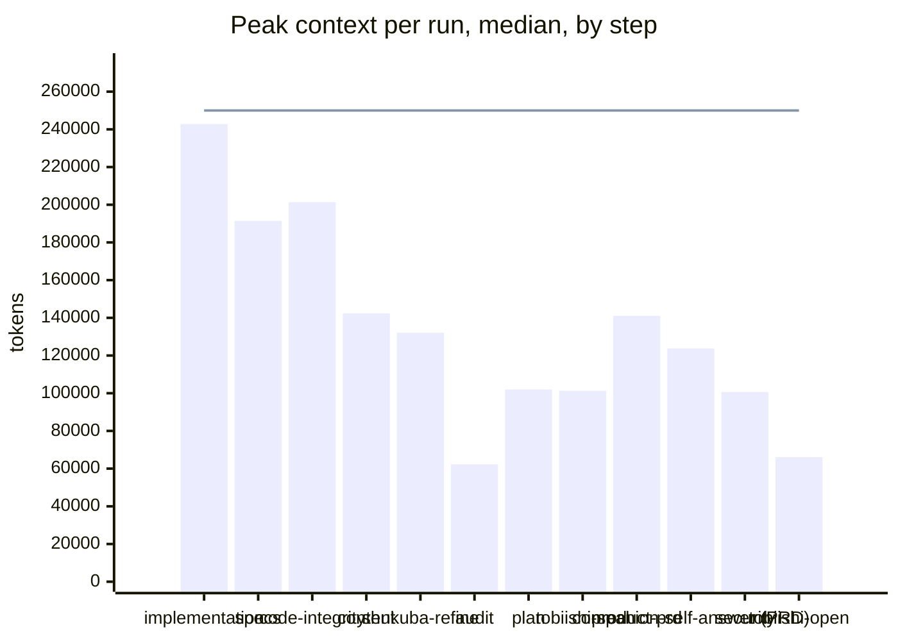
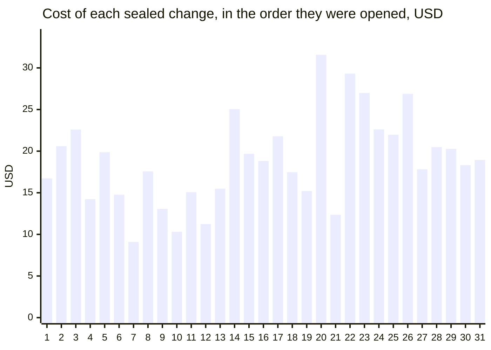
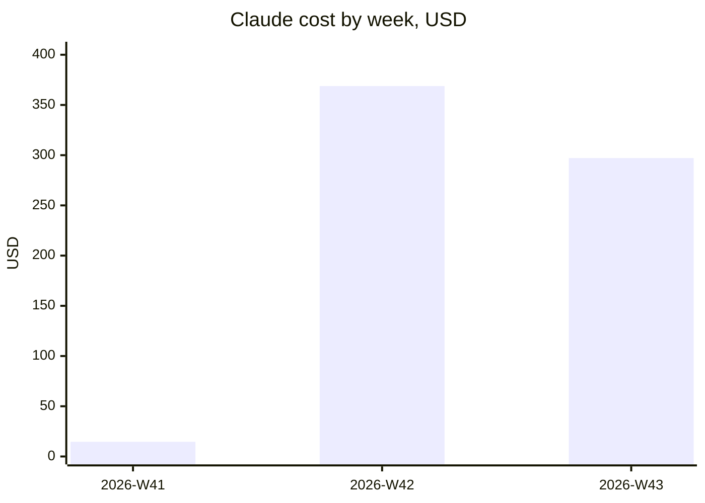

# What building ka-telemetry cost

ka-telemetry was built by KensaiApp's roles, each step a Claude Code run. From 2026-10-11 to 2026-10-24 that took **590 runs**, **13,315 model requests** and **$680.52** of Claude usage. One change, every walk it took counted, typically cost **$18.82**.

Every figure below is what Claude Code reported for each request, never a price worked out from tokens. Runs on Codex, and interactive sessions, are not counted. How each figure is measured is at the end. A step is one of KensaiApp's skills; its [glossary](https://github.com/eyalgo/kensaiapp/blob/main/about/glossary.md) says what each one does. The figures start when telemetry was first received for this project; work done before 2026-10-11 is not in them.

## Cost by model and effort

| model · effort | runs | entry | peak, median | peak, max | requests/run | minutes/run | $/run | $ total | cache hit |
|---|--:|--:|--:|--:|--:|--:|--:|--:|--:|
| claude-opus-5-5 · high | 118 | 22,038 | 165,540 | 303,855 | 37 | 9.4 | $2.75 | $324.30 | 96.3% |
| claude-sonnet-5-5 · medium | 400 | 22,480 | 70,634 | 302,787 | 12 | 1.3 | $0.66 | $263.95 | 95.1% |
| claude-opus-5-5 · medium | 37 | 25,681 | 130,524 | 191,071 | 35 | 7.3 | $2.01 | $74.32 | 96.1% |
| claude-fable-5-1 · medium | 4 | 23,788 | 100,652 | 105,918 | 12 | 3.2 | $2.58 | $10.33 | 87.7% |
| claude-sonnet-5-5 · low | 29 | 23,126 | 53,244 | 80,093 | 10 | 3.6 | $0.26 | $7.58 | 88.8% |
| claude-haiku-5-5 · low | 2 | 23,972 | 50,991 | 57,984 | 13 | 0.8 | $0.02 | $0.04 | 90.5% |

## Context: where each run starts and how large it grows

A run starts with its instructions and the files it is handed (*entry*). Each request then carries the whole conversation so far, so the context grows until the run ends (*peak*). The line is the 250,000-token cap the change chain sets on a developer run; it takes effect only once the task in progress finishes, so a run can pass it.

| step | runs | entry | peak, median | peak, max | over the cap | requests/run | minutes/run | $/run | $ total | cache hit |
|---|--:|--:|--:|--:|--:|--:|--:|--:|--:|--:|
| development-implementation | 75 | 23,475 | 242,793 | 302,787 | 36 | 47 | 15.1 | $1.95 | $146.59 | 97.2% |
| development-specs | 37 | 21,975 | 191,426 | 303,855 | 6 | 50 | 14.4 | $3.67 | $135.76 | 97.0% |
| development-code-integrity | 22 | 22,964 | 201,377 | 262,544 | 2 | 48 | 20.0 | $3.61 | $79.34 | 97.1% |
| development-content | 35 | 22,031 | 142,390 | 231,649 | 0 | 23 | 5.6 | $2.00 | $69.87 | 94.1% |
| shukuba-refine | 32 | 25,657 | 132,074 | 163,676 | 0 | 35 | 7.8 | $2.01 | $64.43 | 96.1% |
| development-audit | 160 | 22,333 | 62,323 | 121,888 | 0 | 11 | 1.2 | $0.31 | $49.56 | 89.1% |
| development-plan | 35 | 22,086 | 102,007 | 166,268 | 0 | 14 | 2.9 | $0.62 | $21.53 | 89.8% |
| tobiishi-seal | 35 | 25,602 | 101,277 | 123,671 | 0 | 12 | 1.2 | $0.46 | $16.13 | 90.4% |
| product-prd | 9 | 20,612 | 141,038 | 168,074 | 0 | 29 | 4.4 | $1.74 | $15.66 | 95.1% |
| companion-self-answer (PRD) | 8 | 20,201 | 123,764 | 160,522 | 0 | 27 | 4.7 | $1.76 | $14.10 | 95.2% |
| development-security | 4 | 23,788 | 100,652 | 105,918 | 0 | 12 | 3.2 | $2.58 | $10.33 | 87.7% |
| tobiishi-open | 33 | 25,787 | 66,100 | 86,909 | 0 | 10 | 0.8 | $0.31 | $10.29 | 87.1% |
| nemawashi-refine | 5 | 26,797 | 123,130 | 191,071 | 0 | 32 | 4.2 | $1.98 | $9.89 | 96.0% |
| readme-status | 28 | 21,961 | 63,983 | 93,582 | 0 | 12 | 0.8 | $0.31 | $8.78 | 89.3% |
| shukuba-open | 24 | 25,686 | 67,840 | 92,630 | 0 | 12 | 1.0 | $0.35 | $8.33 | 90.7% |
| shukuba-retire | 28 | 23,132 | 53,313 | 80,093 | 0 | 10 | 4.0 | $0.26 | $7.33 | 89.0% |
| project-agari | 4 | 20,606 | 88,454 | 133,980 | 0 | 17 | 2.1 | $0.99 | $3.94 | 92.7% |
| companion-self-answer (Agari) | 2 | 23,072 | 111,746 | 129,704 | 0 | 28 | 3.3 | $1.42 | $2.84 | 95.6% |
| first-what-left | 1 | 20,628 | 155,841 | 155,841 | 0 | 43 | 17.1 | $2.79 | $2.79 | 93.9% |
| stations-from-seed | 5 | 26,574 | 66,179 | 88,707 | 0 | 9 | 1.0 | $0.32 | $1.62 | 88.5% |
| nemawashi-pick | 5 | 26,575 | 49,791 | 56,027 | 0 | 8 | 0.5 | $0.23 | $1.14 | 86.5% |
| nemawashi-retire | 3 | 23,906 | 49,968 | 57,984 | 0 | 12 | 0.6 | $0.10 | $0.29 | 88.8% |

## Writing the product's documents

Before any change, KensaiApp's definition roles write the product down, document by document. Each document's run parks what it cannot settle in a companion file of open questions, and a later run answers them and writes the document again. Writing the documents cost **$36.54** in all.

| document | runs | writing | answering its questions | total |
|---|--:|--:|--:|--:|
| PRD | 17 | $15.66 | $14.10 | $29.75 |
| Agari | 6 | $3.94 | $2.84 | $6.79 |

## What a change costs

31 changes were walked to their seal. A change typically cost **$18.82**, the highest $31.57, $586.14 in all. 14 of them halted and were resumed, so their cost spans more than one walk; each change is counted whole. 2 more were not sealed when the data ends, dropped or still being walked, and are left out.

## What a walk costs

A walk is one launch of a chain, and every run it started: *change* carries a change toward its seal, *product* and *agari* write the product's documents, *build-idea* moves the journey between changes.

| chain | walks | median | highest | total |
|---|--:|--:|--:|--:|
| change | 49 | $11.73 | $26.99 | $586.82 |
| agari | 6 | $4.70 | $13.68 | $35.64 |
| build-idea | 29 | $0.60 | $3.60 | $24.15 |
| (none) | 1 | $17.92 | $17.92 | $17.92 |
| development | 1 | $15.99 | $15.99 | $15.99 |

## The most expensive runs

| started (UTC) | step | model · effort | cost | requests | peak | minutes |
|---|---|---|--:|--:|--:|--:|
| 2026-10-12 14:04 | development-specs | claude-opus-5-5 · high | $6.15 | 68 | 303,855 | 22 |
| 2026-10-19 21:00 | development-code-integrity | claude-opus-5-5 · high | $5.70 | 60 | 259,813 | 21 |
| 2026-10-13 15:23 | development-specs | claude-opus-5-5 · high | $5.69 | 66 | 254,590 | 14 |
| 2026-10-12 12:02 | development-specs | claude-opus-5-5 · high | $5.54 | 61 | 281,359 | 20 |
| 2026-10-12 17:45 | development-specs | claude-opus-5-5 · high | $5.35 | 63 | 278,165 | 17 |

## Cost by week

## How it was measured

- Source: the OpenTelemetry events Claude Code sent while the runs worked, received by ka-telemetry, keeping the runs labelled `kensai.project=ka-telemetry` in the KensaiApp instance that builds open-source tools.
- A run is one `kensai.run_id`. Only `claude_code.api_request` events of the main agent count; helper calls inside a run, such as a web search or fetch, are left out.
- A request's context is its input + cache-read + cache-write tokens. *Entry* is a run's first request's context, *peak* its largest.
- *Cost* is the `cost_usd` Claude Code reported. *$/run* is the average, so runs × $/run is the total. *Cache hit* is cache-read tokens over all input tokens.
- *Minutes* run from a run's first request to its last. A walk is every run sharing one `kensai.walk_id`.
- A change is the walks of the change and development chains from one walk that opens it and writes its spec to the next, in start order; a project walks one change at a time. A walk that only opened a change counts toward the change after it. A change counts once a walk sealed it.
- A run started by a launcher arm rather than a skill, such as the self-answer of a document's open questions, is named by that arm and the document.
- Generated 2026-10-24 from data up to 2026-10-24 15:53 UTC.
